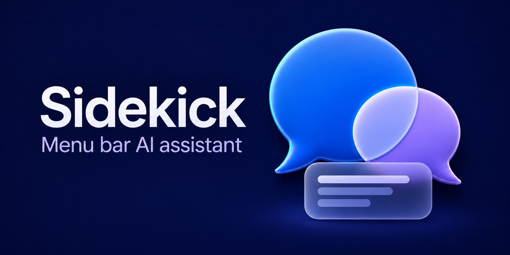

# Sidekick

English | [简体中文](README.zh-CN.md)

[](https://github.com/nervouna/sidekick/actions/workflows/verify.yml)
[](https://github.com/nervouna/sidekick/releases/latest)

[](LICENSE)



Sidekick is a native macOS menu bar app for AI chat. It streams answers from DeepSeek V4 Flash and searches the web with Tavily when a question needs current information.

<!-- screenshots -->

## Status

Sidekick is a personal project at version 0.1. It needs an Apple silicon Mac with macOS 14 or later, and your own DeepSeek and Tavily API keys; DeepSeek bills you for the tokens and Tavily for the searches. The interface is in Simplified Chinese; Sidekick answers in the language of your question. Releases on GitHub are signed with a Developer ID and notarized by Apple; the latest is v0.1.0.

## How it is built

Most of the code is written by coding agents. `AGENTS.md` holds the rules they follow: confirmed work is committed and pushed straight to `main` without pull request review, any build handed to a person for testing is signed with a Developer ID (never ad hoc), and public releases are notarized through the release workflow in `.agents/skills/release-sidekick-macos`. CI runs the unit tests and a dry run of the release script on every push to `main`. See [CONTRIBUTING.md](CONTRIBUTING.md) to report a bug or send a fix, and [SECURITY.md](SECURITY.md) for security problems.

## Download

[Download the latest macOS build](https://github.com/nervouna/sidekick/releases/latest/download/Sidekick-macOS-arm64.zip)

The download is for Apple silicon Macs. Unzip it, move `Sidekick.app` to `/Applications` and open it. Then enter your DeepSeek and Tavily API keys in its settings.

## Usage

- Click the sparkle icon in the menu bar to open the chat, or press the global shortcut `⌥Space` to open and close it from anywhere. The cursor is already in the input field when it opens.
- `Esc` closes the popover. While an input method is active, the first `Esc` closes its candidate window.
- To change the shortcut, click the shortcut field in Settings and press the new combination; `Delete` restores the default. A shortcut must include `⌃`, `⌥` or `⌘`; function keys work on their own.
- If the shortcut does nothing, another app probably uses it. Pick a different combination.
- `Return` sends, `Shift+Return` adds a line break.
- A message can be up to 1,000 characters. Longer text stays in the field for editing but cannot be sent.
- 使用剪贴板 (Use clipboard) attaches the text on the clipboard to the next question, up to 4,000 characters. 移除 (Remove) takes it off again.
- Your messages, the replies and streaming text are rendered as Markdown.
- Right-click the menu bar icon for 设置… (Settings…) and 退出 Sidekick (Quit Sidekick).
- The current conversation is temporary context that lasts 30 minutes. It is cleared the next time you open the popover or send a message after that.
- To limit cost, latency and what is sent, older complete exchanges may be dropped from the context. The interface says so, and they are removed from the temporary session file as well.
- Answers that were cancelled, hit the length limit, were filtered or broke off are still shown but are left out of later context. 重试 (Retry) replaces such an answer.
- Sidekick has no long-term memory, history search or recall across conversations.

## Keys, data and network

- **API keys** entered in Settings are stored in the macOS Keychain (service `io.damao.sidekick`, accounts `deepseek` and `tavily`). A key in the Keychain takes precedence over the `DEEPSEEK_API_KEY` and `TAVILY_API_KEY` environment variables. 删除密钥 (Delete keys) in Settings removes them from the Keychain.
- **DeepSeek** (`api.deepseek.com`) receives each question with the current conversation, any attached clipboard text, the search results for that question, and a system prompt that includes your local date and time, time zone and locale.
- **Tavily** (`api.tavily.com`) receives the search queries the model writes, at most two per question. Your messages are not sent to Tavily as such.
- 验证连接 (Verify connection) in Settings sends each key to its own service to check it.
- **On disk**: the current conversation is kept in `~/Library/Application Support/Sidekick/current-session.json` for its 30 minutes; the shortcut is in the app's user defaults (`io.damao.sidekick`).
- The clipboard is read only when you click 使用剪贴板 (Use clipboard).
- Images in replies are shown as placeholders, not loaded from the network.
- Sidekick sends nothing else and has no analytics.

## Uninstall

1. In Settings, turn off 登录时打开 (Open at login) and click 删除密钥 (Delete keys).
2. Right-click the menu bar icon, choose 退出 Sidekick (Quit Sidekick), and move `Sidekick.app` to the Trash.
3. To remove the rest of its data:

   ```sh
   rm -rf ~/Library/Application\ Support/Sidekick
   defaults delete io.damao.sidekick
   ```

## Development

Building needs Xcode 16 / Swift 6 or later.

### Local debugging

The `.env` file in the project root uses these variable names:

```dotenv
DEEPSEEK_API_KEY=...
TAVILY_API_KEY=...
```

`.env` is ignored by Git and never goes into the app bundle. Start a debug build:

```sh
./scripts/run_debug.sh
```

For automated UI checks, a debug build can open the popover at launch: `Sidekick --open-on-launch`. The flag only works in Debug builds.

Keys can also be entered in the app's settings; those are stored in the Keychain and take precedence over the environment variables.

### Build and verify

```sh
./scripts/build_app.sh
./scripts/verify.sh
```

For a minimal live API check with the keys in `.env` (it uses a few DeepSeek tokens and one Tavily search credit):

```sh
./scripts/smoke_api.sh
```

After changing the system prompt, you can run a live model evaluation. It uses `DEEPSEEK_API_KEY` from `.env` and a few DeepSeek tokens, but fixed search results, so no Tavily credit; it is not part of `verify.sh`:

```sh
./scripts/eval_prompt.sh
```

The local debug app is built to `build/Sidekick.app`. It is signed ad hoc for development and personal debugging only and is not a release artifact; signed, notarized builds for users come from GitHub Releases.

## License

MIT, see [LICENSE](LICENSE).
